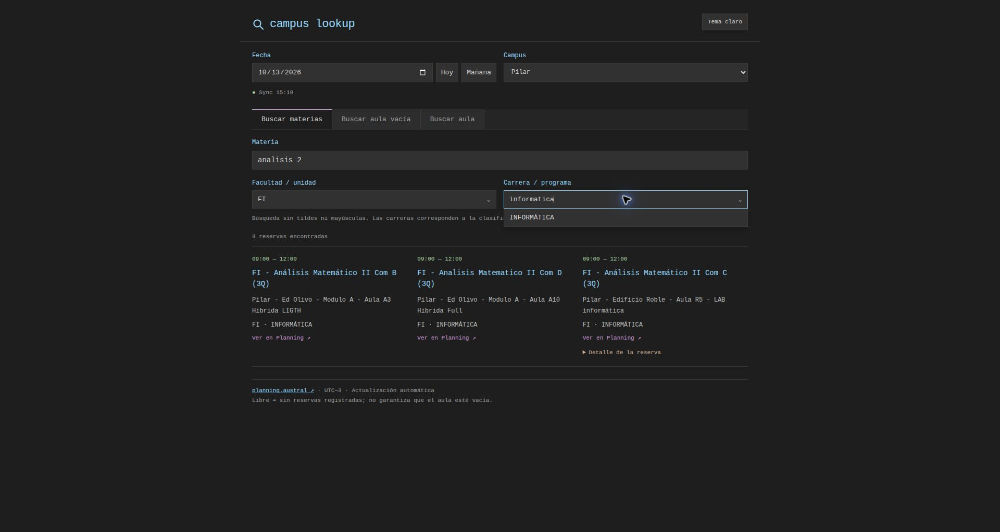
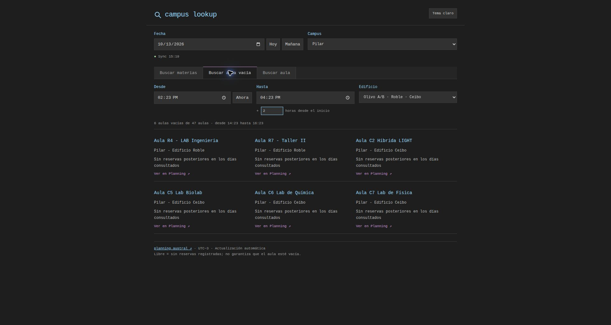
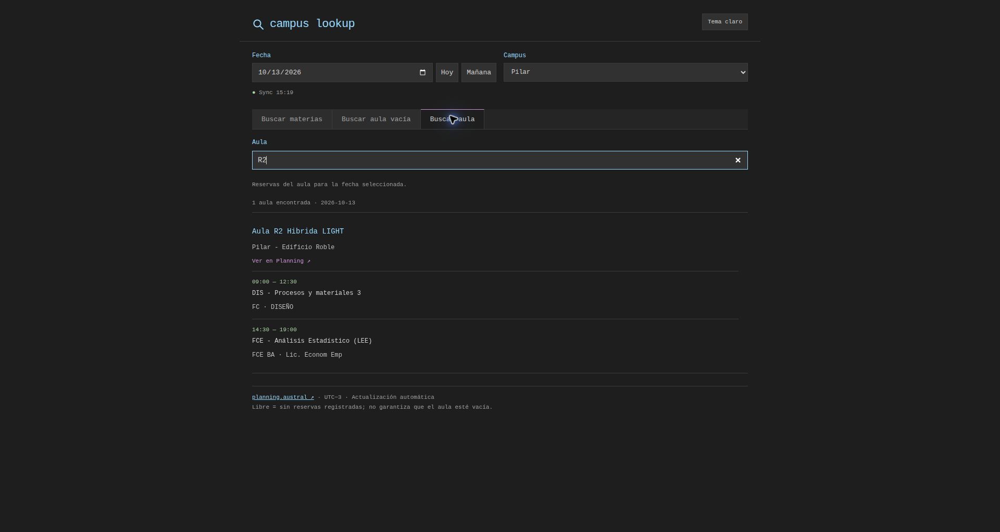
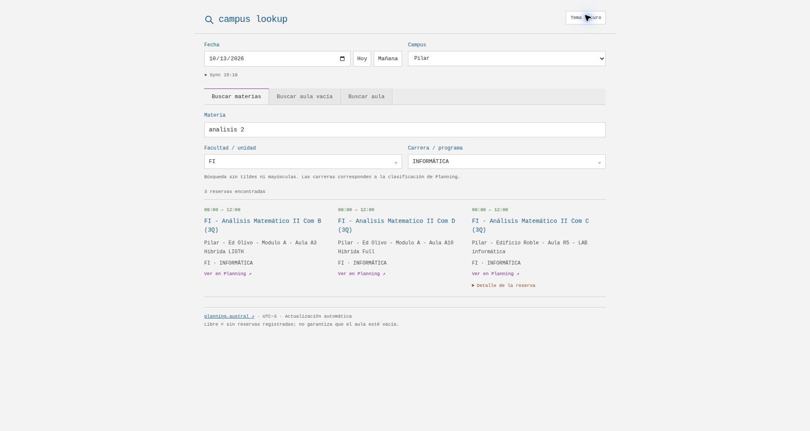

# campus lookup

Buscador de aulas de materias, aulas vacías y cronogramas por aula de Austral. Sin login. Requiere **Python 3.10+**, internet y un navegador moderno.

## Instalar y usar · Linux

Descargá el repositorio como ZIP y extraelo donde quieras, o clonalo:

```bash
git clone https://github.com/Vontk/planning-austral.git
cd planning-austral
```

Desde una terminal en esa carpeta, ejecutá **sin sudo**:

```bash
python3 setup.py
```

El setup requiere **Linux con systemd** y abre la app. Después entrá a **http://campus-lookup.localhost:18787/** cuando quieras; guardalo en favoritos con **Ctrl+D** como **campus lookup**. El enlace inicia Python automáticamente, también después de volver a iniciar sesión. Si el nombre local no funciona en tu navegador, usá **http://127.0.0.1:18787/**.

Elegí fecha y campus y usá **Buscar materias**, **Buscar aula vacía** o **Buscar aula**. Los horarios se actualizan automáticamente. La búsqueda ignora tildes y mayúsculas (`analisis 2` encuentra `Análisis II`). Tocá los filtros de facultad y carrera para elegir una opción o escribir y reducir la lista.

Conservá la carpeta: si la movés, volvé a ejecutar el setup.

## Windows y macOS · setups no testeados

Descargá y extraé el mismo repositorio. Desde una terminal en su carpeta:

**Windows:**

```powershell
py -3 setup_windows.py
```

Instala y abre el enlace **campus-lookup://open** y crea un acceso directo en `%LOCALAPPDATA%\campus-lookup.url`. Ese enlace inicia Python y abre la app; el navegador puede pedir permiso para abrir la aplicación local. Usá ese enlace o acceso directo para volver a abrirla: la URL HTTP sola no inicia Python en Windows.

**macOS:**

```bash
python3 setup_macos.py
```

Instala el inicio automático con launchd y abre la app. Después usá **http://campus-lookup.localhost:18787/**, igual que en Linux.

**Estos setups todavía no fueron testeados en Windows/macOS.** El método manual debería funcionar en ambos sistemas, y también en Linux sin systemd:

```bash
python3 server.py
```

En Windows, usá `py -3 server.py`. Se abre el navegador predeterminado; en el método manual ejecutá ese comando cada vez que quieras abrir la app.

## Cierre automático

Tanto con setup como con el método manual, **Python termina automáticamente unos 6–9 segundos después de cerrar la última pestaña**. No queda un proceso de Python consumiendo recursos. Si dejás una pestaña abierta, incluso en segundo plano, sigue funcionando.

Para mantenerlo activo y cerrarlo manualmente con **Ctrl+C**:

```bash
python3 server.py --nokill
```

En Windows: `py -3 server.py --nokill`. Si el setup u otra instancia ya tiene ocupado el puerto, agregá `--port 18788` para abrir esta instancia manual en otro puerto.

## Capturas

### Buscar materias



### Buscar aula vacía



### Cronograma de un aula



### Tema claro


