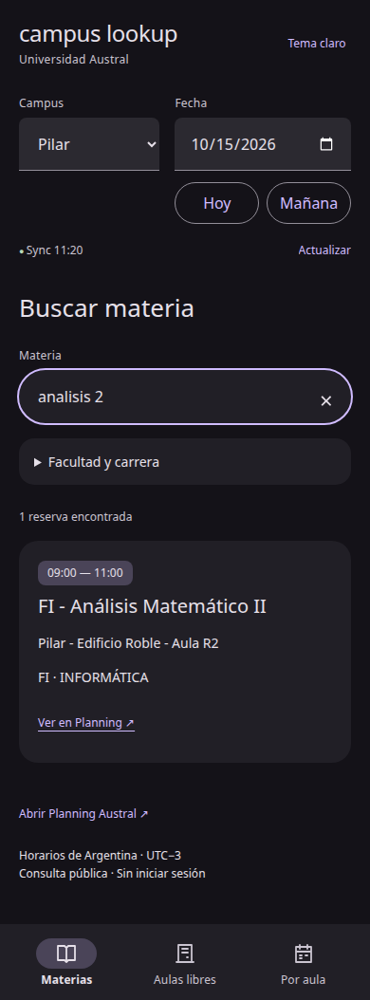
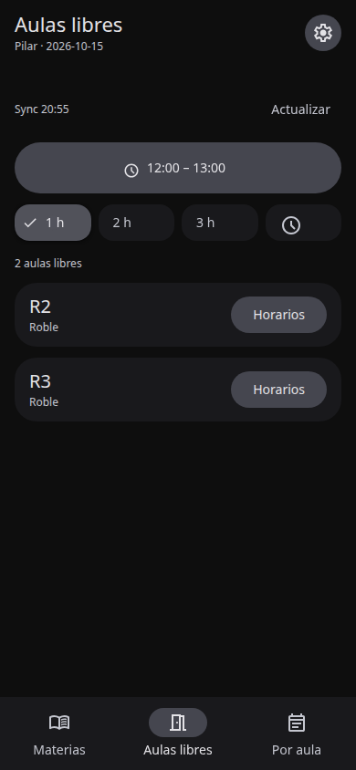
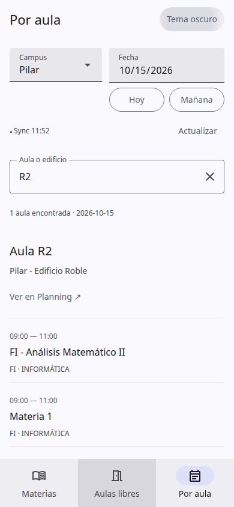
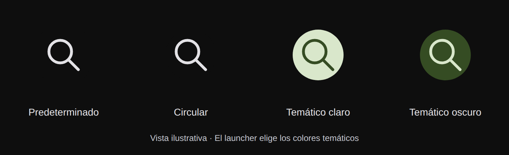

# campus lookup · Android

Install the signed APK from [GitHub Releases](https://github.com/Vontk/planning-austral/releases/latest). Android 8.0+ (API 26), internet, and a recent Android System WebView are required. No Python or computer is needed. Allow installation from the browser or file manager when Android prompts.

## Android 2.0.0

The Android interface was redesigned around Material 3: system sans-serif typography, tonal surfaces, rounded search fields, filled and outlined actions, filter chips, and a navigation bar with pill-shaped selection indicators. Official Material Web buttons, chips and ripples are bundled locally with Lit; only the used components are imported and minified. There are no remote fonts, CDN requests or additional Android permissions. Native date/time pickers remain provided by the system WebView.

Android 12+ system accent and neutral resources supply the palette. Android follows system night mode, including changes through Activity recreation; it ignores previously saved manual themes. Older versions use light/dark Material fallback palettes. Browser previews retain a manual theme control.

A native FrameLayout owns system-bar, display-cutout and IME insets and resizes the WebView's actual viewport. Insets already applied by the parent are zeroed before reaching WebView. Fixed bottom navigation stays within that viewport, avoiding the former status-bar overlap on Android's enforced edge-to-edge layouts.

Results allocate at most 30 cards initially and add batches on request, instead of rendering all cards and hiding them. Networking and polling pause in the background as before. APK size is measured at release time; no device RAM benchmark is claimed.

Chromium checks cover 320, 360, 390, 412 and 768 px, enlarged controls, both themes, native palette precedence, filters, pagination allocation, overnight intervals, saved searches and connection failure/retry. Screenshots use synthetic reservations and browser rendering, not physical-device captures.

| Materias | Aulas libres | Por aula · claro |
| --- | --- | --- |
|  |  |  |

## Ícono de Android

Desde 1.0.1 el launcher usa un ícono adaptativo: fondo oscuro opaco en toda la máscara, lupa celeste dentro de la zona segura y variante monocromática para Android 13+. `icon` y `roundIcon` apuntan al mismo recurso adaptativo para evitar el fondo blanco que algunos launchers agregan a los íconos antiguos.



## Build

Install JDK 21 and an Android SDK with `platforms;android-35` and `build-tools;35.0.0`. Set `ANDROID_HOME` or `android/local.properties` (`sdk.dir=...`).

```sh
npm ci --prefix mobile
python3 scripts/build-mobile.py
node tests/app.test.cjs
python3 -m unittest discover -s tests
(cd mobile && npx playwright install chromium)
NODE_PATH="$PWD/mobile/node_modules" node tests/mobile.cjs
(cd android && ./gradlew assembleRelease testReleaseUnitTest lintRelease)
```

`mobile/` owns the Android interface. `scripts/build-mobile.py` bundles the existing `index.html` Planning engine with this interface, avoiding divergent availability and fuzzy-search implementations. Regenerate committed assets after editing either source. The desktop interface and Python launcher continue working as before.

The APK uses a bundled WebView interface on `https://appassets.androidplatform.net/`, following Android's HTTPS-origin approach to [local WebView content](https://developer.android.com/develop/ui/views/layout/webapps/load-local-content). Native networking permits only public `day.php` and `report.php` requests to the fixed Austral HTTPS origin, enforces timeouts and a 10 MB response bound, and rejects redirects. Cookies, cleartext traffic, file access, content access, and JavaScript bridges are disabled. Public links open in the system browser. Preferences stay in app-local storage. No analytics, trackers, account, or hosted intermediary.

## Signing and releases

The private key is never committed. Supply `CAMPUS_SIGNING_DIR` containing `release.p12` (alias `campuslookup`) and a `password` file, then run:

```sh
ANDROID_HOME=/path/to/sdk CAMPUS_SIGNING_DIR=/private/signing scripts/sign-android.sh 2.0.0
```

The script aligns, signs, verifies, and hashes the APK into ignored `artifacts/`. Preserve the original key for compatible updates. GitHub Actions verifies branches, PRs, and `android-v*` tags and produces unsigned build artifacts. Sign verified builds locally, then attach the signed APK and SHA256SUMS to the GitHub release. Signing credentials stay local in the ignored `.signing/` directory; keep a private backup. Bump versionCode/versionName in `android/app/build.gradle.kts` before a subsequent tag.

## Verification limits

Local release compilation, Android lint, native unit tests, shared engine tests, Python regression tests, and Chromium mobile interaction tests passed. Public `day.php` and CSV `report.php` endpoints were fetched successfully. No physical Pixel 10 or Android emulator was available for this release; keyboard, system date/time pickers, OEM WebView differences, and device installation have not been exercised. Browser screenshots do not claim device verification.
