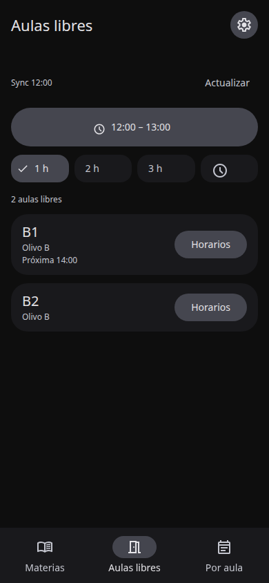

# campus lookup · Android

Install the signed APK from [GitHub Releases](https://github.com/Vontk/planning-austral/releases/latest). Android 8.0+ (API 26), internet, and a recent Android System WebView are required. No Python or computer is needed. Allow installation from the browser or file manager when Android prompts.

## Android 2.1.0

The interface starts in Aulas libres with today's Argentina date, the opening time and a one-hour interval. Campus preference remains local; old saved dates, modes and intervals no longer override the initial search. The gear opens official Material settings for campus/date/building; a clock opens custom start/end/duration controls. Quick durations are 1/2/3 hours plus an icon-only custom clock chip with an accessible label. Filled tonal controls and rounded result cards replace outlined actions. Tutorial copy, the footer and the Sync marker are removed.

Room labels use their codes (A1, B2, C8.1, R2) without changing source identities. Exactly two known halves, .1 and .2 in the same building/campus, merge for a free-room interval only when both are confirmed free. Daily schedules merge only if every reservation's times, title, classification and details match; identical subject bookings also collapse into one result. Unknown mappings, extra subdivisions, occupied halves and differing schedules stay separate. The earliest known next reservation is shown for a merged free room.

Ten presentation/grouping tests and browser integration cases cover these rules, alongside the existing engine and mobile workflows. The image below uses synthetic data and browser rendering. The signed APK uses the existing release key and versionCode 5.



## Android 2.0.1

The remaining CSS-drawn controls were replaced with official `@material/web` components: outlined search and academic text fields, filled campus/building selects and options, filled date/time text fields wrapping the browser inputs, icon buttons, circular progress, and navigation bar/tabs. Navigation comes from the package's official **labs** modules (experimental upstream), not a custom replica. Buttons and filter chips remain official components. The layout and result lists are app-specific. Calendar/time picker dialogs continue to come from Android WebView; Material Web lists date/time input types as partially supported, and their Android dialogs still require device verification.

Icons are official Google Material Symbols SVGs included locally. No icon font, CDN or new permissions. Component initialization completes before the Planning engine starts. The navigation component now owns keyboard focus and selection behavior. Tests verify actual shadow-root controls, typed text visibility after transitions, dropdown changes and accessibility scaling through Material typography tokens.

The dark reference palette uses `#0e0e0e` for content and `#19191c` for navigation. Neutrals and navigation selection stay subdued; action accents still come from the Android system palette. The header displays the current page and removes the redundant subtitle and large secondary title.

The native safe-area container paints its bottom inset with the navigation surface color, while keeping WebView controls above that inset. This removes the contrasting strip under the bottom bar; status bar and camera-safe padding remain intact. Android 8.0 retains a dark system navigation area for visible system icons.

## Android 2.0.0 · previous iteration

The Android interface was redesigned around Material 3: system sans-serif typography, tonal surfaces, rounded search fields, filled and outlined actions, filter chips, and a navigation bar with pill-shaped selection indicators. Official Material Web buttons, chips and ripples are bundled locally with Lit; only the used components are imported and minified. There are no remote fonts, CDN requests or additional Android permissions. Native date/time pickers remain provided by the system WebView.

Android 12+ system accent and neutral resources supply the palette. Android follows system night mode, including changes through Activity recreation; it ignores previously saved manual themes. Older versions use light/dark Material fallback palettes. Browser previews retain a manual theme control.

A native FrameLayout owns system-bar, display-cutout and IME insets and resizes the WebView's actual viewport. Insets already applied by the parent are zeroed before reaching WebView. Fixed bottom navigation stays within that viewport, avoiding the former status-bar overlap on Android's enforced edge-to-edge layouts.

Results allocate at most 30 cards initially and add batches on request, instead of rendering all cards and hiding them. Networking and polling pause in the background as before. APK size is measured at release time; no device RAM benchmark is claimed.

Chromium checks cover 320, 360, 390, 412 and 768 px, enlarged controls, both themes, native palette precedence, filters, pagination allocation, overnight intervals, saved searches and connection failure/retry. Screenshots use synthetic reservations and browser rendering, not physical-device captures.

| Materias | Aulas libres | Por aula · claro |
| --- | --- | --- |
|  |  |  |

## Android launcher and platform review · 2.0.1

The default adaptive icon now uses `#0e0e0e` and `#e3e2e6`, matching the interface. A transparent monochrome vector lets Android 13+ launchers apply the user's wallpaper palette in themed-icon mode. Both `icon` and `roundIcon` resolve to the same adaptive resource, including its monochrome layer. Older Android versions ignore that newer layer. The 108 dp vector keeps its foreground within the central 66 dp safe zone and requires no raster-density copies.


The themed colors in this preview are illustrative; the launcher chooses the actual colors. Users must enable themed icons in a supporting launcher. See [Android adaptive icons](https://developer.android.com/develop/ui/views/launch/icon_design_adaptive).

The review covered icon resources, system-bar/cutout/IME handling, system theme, control labels/focus/touch targets, permission scope and backup settings. Explicit Android 12+ cloud-backup and device-transfer exclusions now match `allowBackup=false`, and legacy cloud backups remain disabled. Only INTERNET is declared; there are no notification, storage, location, wallpaper-read or boot permissions. No new runtime library was added to the native wrapper. A clean release build, native tests and Android Lint passed with **no issues found**. This is a scoped project review, not certification of all Android requirements; TalkBack, launcher theming, installation and gesture behavior still require physical-device checks.

## Build

Install JDK 21 and an Android SDK with `platforms;android-35` and `build-tools;35.0.0`. Set `ANDROID_HOME` or `android/local.properties` (`sdk.dir=...`).

```sh
npm ci --prefix mobile
python3 scripts/build-mobile.py
node tests/app.test.cjs
python3 -m unittest discover -s tests
(cd mobile && npx playwright install chromium)
NODE_PATH="$PWD/mobile/node_modules" node tests/mobile.cjs
(cd android && ./gradlew assembleRelease testReleaseUnitTest lintRelease)
```

`mobile/` owns the Android interface. `scripts/build-mobile.py` bundles the existing `index.html` Planning engine with this interface, avoiding divergent availability and fuzzy-search implementations. Regenerate committed assets after editing either source. The desktop interface and Python launcher continue working as before.

The APK uses a bundled WebView interface on `https://appassets.androidplatform.net/`, following Android's HTTPS-origin approach to [local WebView content](https://developer.android.com/develop/ui/views/layout/webapps/load-local-content). Native networking permits only public `day.php` and `report.php` requests to the fixed Austral HTTPS origin, enforces timeouts and a 10 MB response bound, and rejects redirects. Cookies, cleartext traffic, file access, content access, and JavaScript bridges are disabled. Public links open in the system browser. Preferences stay in app-local storage. No analytics, trackers, account, or hosted intermediary.

## Signing and releases

The private key is never committed. Supply `CAMPUS_SIGNING_DIR` containing `release.p12` (alias `campuslookup`) and a `password` file, then run:

```sh
ANDROID_HOME=/path/to/sdk CAMPUS_SIGNING_DIR=/private/signing scripts/sign-android.sh 2.1.0
```

The script aligns, signs, verifies, and hashes the APK into ignored `artifacts/`. Preserve the original key for compatible updates. GitHub Actions verifies branches, PRs, and `android-v*` tags and produces unsigned build artifacts. Sign verified builds locally, then attach the signed APK and SHA256SUMS to the GitHub release. Signing credentials stay local in the ignored `.signing/` directory; keep a private backup. Bump versionCode/versionName in `android/app/build.gradle.kts` before a subsequent tag.

## Verification limits

Local release compilation, Android lint, native unit tests, shared engine tests, Python regression tests, and Chromium mobile interaction tests passed. Public `day.php` and CSV `report.php` endpoints were fetched successfully. No physical Pixel 10 or Android emulator was available for this release; keyboard, system date/time pickers, OEM WebView differences, and device installation have not been exercised. Browser screenshots do not claim device verification.
