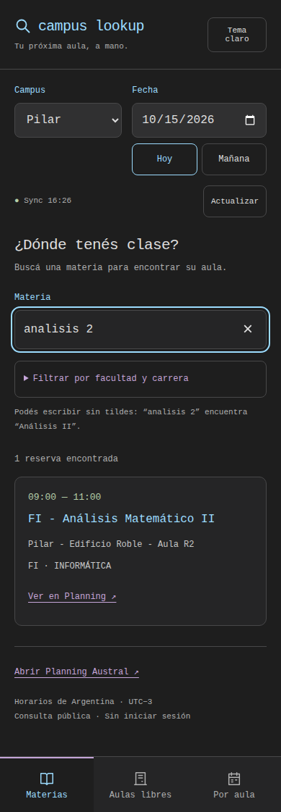
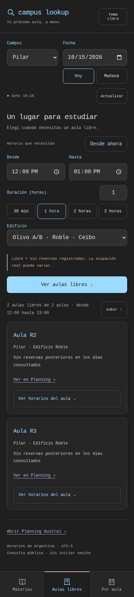
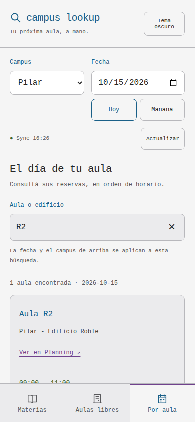
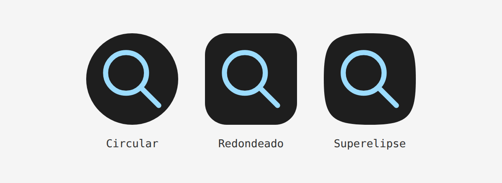

# campus lookup · Android

Install the signed APK from [GitHub Releases](https://github.com/Vontk/planning-austral/releases/latest). Android 8.0+ (API 26), internet, and a recent Android System WebView are required. No Python or computer is needed. Allow installation from the browser or file manager when Android prompts.

## Interface iterations

The existing charcoal/monospace visual language and light palette are preserved. The first pass moved the three tasks into persistent bottom navigation, enlarged controls, put academic filters behind a disclosure, introduced loading/retry states, and made free-room cards link to the room schedule. A browser review then exposed stale pagination after typing; listeners now dispatch through the mobile renderer. A second pass reduced scrolling with side-by-side start/end times, quick duration chips, and an explicit results action. Search changes reset pagination; the full count remains visible while cards appear in batches of 30.

Checks cover 320, 360, 390, 412, and 768 px layouts, enlarged control text, both themes, filters, clear actions, overnight intervals, invalid durations, saved searches, connection failure/retry, and discarding stale results. Screenshots below use synthetic test reservations, not live schedules.

| Materias | Aulas libres | Por aula · claro |
| --- | --- | --- |
|  |  |  |

## Ícono de Android

Desde 1.0.1 el launcher usa un ícono adaptativo: fondo oscuro opaco en toda la máscara, lupa celeste dentro de la zona segura y variante monocromática para Android 13+. `icon` y `roundIcon` apuntan al mismo recurso adaptativo para evitar el fondo blanco que algunos launchers agregan a los íconos antiguos.



## Build

Install JDK 21 and an Android SDK with `platforms;android-35` and `build-tools;35.0.0`. Set `ANDROID_HOME` or `android/local.properties` (`sdk.dir=...`).

```sh
python3 scripts/build-mobile.py
node tests/app.test.cjs
python3 -m unittest discover -s tests
npm ci --prefix mobile
(cd mobile && npx playwright install chromium)
NODE_PATH="$PWD/mobile/node_modules" node tests/mobile.cjs
(cd android && ./gradlew assembleRelease testReleaseUnitTest lintRelease)
```

`mobile/` owns the Android interface. `scripts/build-mobile.py` bundles the existing `index.html` Planning engine with this interface, avoiding divergent availability and fuzzy-search implementations. Regenerate committed assets after editing either source. The desktop interface and Python launcher continue working as before.

The APK uses a bundled WebView interface on `https://appassets.androidplatform.net/`, following Android's HTTPS-origin approach to [local WebView content](https://developer.android.com/develop/ui/views/layout/webapps/load-local-content). Native networking permits only public `day.php` and `report.php` requests to the fixed Austral HTTPS origin, enforces timeouts and a 10 MB response bound, and rejects redirects. Cookies, cleartext traffic, file access, content access, and JavaScript bridges are disabled. Public links open in the system browser. Preferences stay in app-local storage. No analytics, trackers, account, or hosted intermediary.

## Signing and releases

The private key is never committed. Supply `CAMPUS_SIGNING_DIR` containing `release.p12` (alias `campuslookup`) and a `password` file, then run:

```sh
ANDROID_HOME=/path/to/sdk CAMPUS_SIGNING_DIR=/private/signing scripts/sign-android.sh 1.0.1
```

The script aligns, signs, verifies, and hashes the APK into ignored `artifacts/`. Preserve the original key for compatible updates. GitHub Actions verifies branches, PRs, and `android-v*` tags and produces unsigned build artifacts. Sign verified builds locally, then attach the signed APK and SHA256SUMS to the GitHub release. Signing credentials stay local in the ignored `.signing/` directory; keep a private backup. Bump versionCode/versionName in `android/app/build.gradle.kts` before a subsequent tag.

## Verification limits

Local release compilation, Android lint, native unit tests, shared engine tests, Python regression tests, and Chromium mobile interaction tests passed. Public `day.php` and CSV `report.php` endpoints were fetched successfully. No physical Android device or emulator was available; keyboard, system date/time pickers, OEM WebView differences, and device installation have not been exercised. Browser screenshots do not claim device verification.
